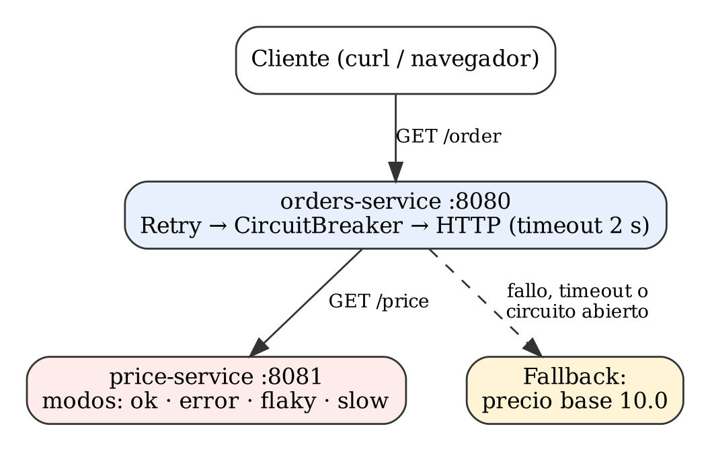

# 01 – Circuit Breaker, Retry y Timeout (Spring Boot + Resilience4j)

## Solución
Dos microservicios sencillos:

- **price-service** (puerto 8081): devuelve un precio y puede simular fallos con `POST /admin/mode/{ok|error|flaky|slow}`.
- **orders-service** (puerto 8080): `GET /order` consulta el precio a *price-service*.
  Está protegido con **Timeout** (2 s), **Retry** (3 intentos, espera 0,5 s y 1 s) y **Circuit Breaker** (ventana de 10 llamadas, abre al 50 % de fallos, 10 s abierto).
  Si todo falla responde con un **precio base (FALLBACK)**.

Orden de ejecución en orders-service: `Retry → CircuitBreaker → llamada HTTP con timeout`.
Los timeouts no se reintentan (el servicio ya está lento) pero sí cuentan como fallo para el circuito.



## Cómo ejecutarlo
Solo necesitas **Docker Desktop** (Java y Maven se usan dentro de Docker).

```bash
cd 01-resilience
docker compose up --build
```

En otra terminal:

```bash
./demo.sh          # Git Bash, WSL, Linux o macOS
```

Para ver solo las transiciones y reintentos:

```bash
docker compose logs orders-service | grep ">>>"
```

### Comandos manuales (PowerShell: usar `curl.exe`)
```bash
curl -X POST http://localhost:8081/admin/mode/error   # cambia el modo
curl http://localhost:8080/order                      # crea un pedido
curl http://localhost:8080/actuator/circuitbreakers   # estado del circuito
```

## Qué debe verse (evidencia)
| Paso | Resultado esperado |
|---|---|
| Modo `ok` | `"source":"PRICE_SERVICE"` |
| Modo `flaky` | 3 llamadas en el log, `>>> RETRY` #1 y #2, respuesta final `PRICE_SERVICE` |
| Modo `slow` | `TIMEOUT` en el log, respuesta `FALLBACK` en ~2 s |
| Modo `error` | 3 intentos por petición; tras 2 peticiones `CLOSED -> OPEN`; luego `FALLBACK` inmediato |
| Volver a `ok` y esperar 10 s | `OPEN -> HALF_OPEN`, luego `HALF_OPEN -> CLOSED` |

Guardar en `docs/evidencia/`: salida de `demo.sh`, logs con `>>>` y captura de `/actuator/circuitbreakers`.
