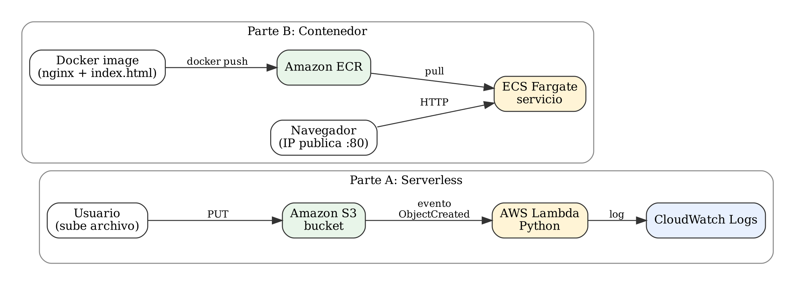

# 02 – Serverless (Lambda + S3) y Docker (ECS Fargate)

## Solución
**Parte A – Serverless.** Un bucket de S3 genera un evento `ObjectCreated` cada vez que se sube un archivo. Ese evento invoca una función **AWS Lambda** (Python) que escribe en **CloudWatch Logs** el nombre y tamaño del archivo. No hay servidores que administrar.

**Parte B – Docker.** Una imagen **Docker** (nginx + una página HTML) se publica en **Amazon ECR** y se ejecuta como servicio en **Amazon ECS con Fargate** (contenedores sin administrar servidores).

## Archivos
- `lambda/lambda_function.py`: código de la función.
- `lambda/test-event.json`: evento de prueba.
- `container/Dockerfile` e `index.html`: imagen del contenedor.

## Evidencia (capturas en `docs/evidencia/02/`)
- Lambda: log en CloudWatch con `NUEVO ARCHIVO: s3://.../prueba.txt`.
- ECS: servicio en estado `RUNNING` y la página abierta desde la IP pública.

## Limpieza
Eliminar el servicio y clúster de ECS, el repositorio ECR, la función Lambda y el bucket S3 al terminar.
