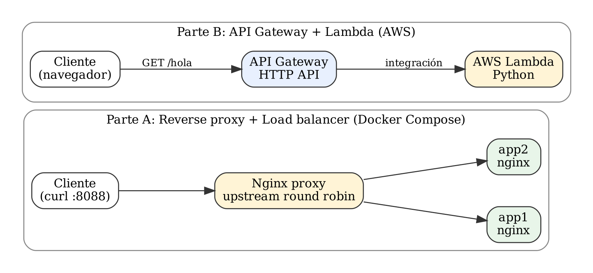

# 03 – Reverse Proxy, Load Balancer y API Gateway

## Solución
**Parte A – Nginx como reverse proxy y balanceador.** Un contenedor Nginx recibe las peticiones en el puerto 8088 y las reparte (*round robin*) entre dos réplicas (`app1` y `app2`). Si una réplica deja de responder, Nginx envía el tráfico a la otra (*failover*).

**Parte B – API Gateway + Lambda.** Un **HTTP API** de Amazon API Gateway recibe la petición `GET /hola` y la envía a una función **AWS Lambda** que devuelve una respuesta JSON.



## Cómo ejecutar la Parte A
```bash
cd 03-proxy-gateway/nginx-lb
docker compose up -d
./demo.sh
docker compose down
```

## Resultado esperado
| Paso | Resultado |
|---|---|
| Round robin | Las respuestas alternan: APP 1, APP 2, APP 1, APP 2... |
| `app1` detenida | Todas las respuestas vienen de APP 2 |
| `app1` reiniciada | Vuelven a alternar |

## Parte B
Código en `api-gateway-lambda/lambda_function.py`. Se prueba abriendo la URL del API en el navegador (`.../hola`).

## Evidencia
Capturas en `docs/evidencia/03/`.

## Limpieza
Eliminar el API de API Gateway y la función Lambda al terminar.
