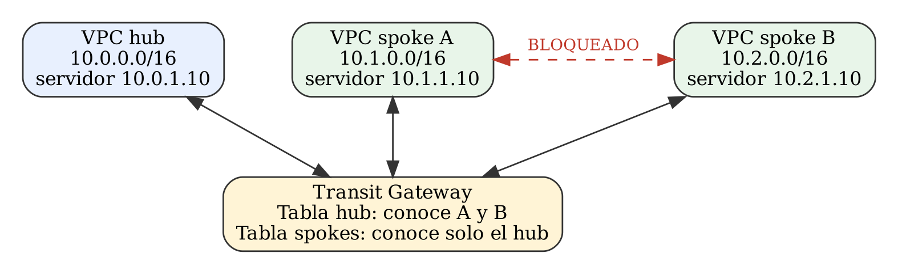

# 04 – Hub-and-Spoke con AWS Transit Gateway (Terraform)

## Solución
Tres redes (VPC) conectadas con un **Transit Gateway**:

| Red | CIDR | Servidor de prueba |
|---|---|---|
| hub (servicios compartidos) | 10.0.0.0/16 | 10.0.1.10 |
| spoke A | 10.1.0.0/16 | 10.1.1.10 |
| spoke B | 10.2.0.0/16 | 10.2.1.10 |

El Transit Gateway tiene **dos tablas de rutas**:
- la del **hub** aprende las rutas de los dos spokes;
- la de los **spokes** aprende solo la ruta del hub.

Resultado: cada spoke llega al hub, pero **spoke A y spoke B no se ven entre sí**.

Cada servidor hace ping a los otros dos y publica el resultado en una página web (`ALCANZABLE` o `BLOQUEADO`).



## Resultado esperado
| Servidor | Hacia hub | Hacia spoke A | Hacia spoke B |
|---|---|---|---|
| hub | – | ALCANZABLE | ALCANZABLE |
| spoke A | ALCANZABLE | – | BLOQUEADO |
| spoke B | ALCANZABLE | BLOQUEADO | – |

## Cómo ejecutarlo (AWS CloudShell)
```bash
git clone https://github.com/Jaquimba23/cloud-patterns-lab.git
cd cloud-patterns-lab/04-hub-and-spoke
terraform init
terraform apply        # escribir: yes
```
Abrir las 3 URLs que muestra `paginas_de_prueba` (esperar 2-3 minutos).

## Limpieza
```bash
terraform destroy      # escribir: yes
```
