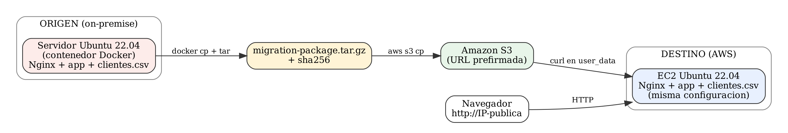

# 05 – Lift-and-Shift (rehosting) a AWS

## Solución
**Lift-and-Shift** consiste en mover una aplicación a la nube **sin cambiar su diseño**: mismo sistema operativo, mismo servidor web, misma configuración y mismos datos.

- **Origen (on-premise):** un servidor Ubuntu 22.04 con Nginx, una aplicación web y el archivo `clientes.csv`, simulado con un contenedor Docker.
- **Lift:** se empaqueta la aplicación y su configuración (`export.sh`) en `migration-package.tar.gz` y se sube a S3.
- **Shift:** Terraform crea una instancia EC2 con Ubuntu 22.04, instala Nginx y extrae el paquete tal cual.
- **Verificación:** el `sha256` de `clientes.csv` en origen y destino debe ser idéntico y la aplicación debe abrirse desde la IP pública.

> En producción esta migración se hace con **AWS Application Migration Service (MGN)**, que replica discos completos de forma continua. En el Learner Lab no se pueden crear los roles de IAM que MGN requiere, por lo que se usó este procedimiento manual con el mismo principio de rehosting.



## Cómo ejecutarlo
**1. Origen (en tu computadora):**
```bash
cd 05-lift-and-shift
docker compose up -d --build     # abre http://localhost:8090
./export.sh                      # crea migration-package.tar.gz e imprime el sha256
```
**2. Subir a S3 y destino (en CloudShell):**
```bash
aws s3 mb s3://NOMBRE-DEL-BUCKET
aws s3 cp migration-package.tar.gz s3://NOMBRE-DEL-BUCKET/
URL=$(aws s3 presign s3://NOMBRE-DEL-BUCKET/migration-package.tar.gz --expires-in 3600)
cd cloud-patterns-lab/05-lift-and-shift/aws
terraform init
terraform apply -var="package_url=$URL"
```
**3. Verificar:**
```bash
curl -s http://IP-PUBLICA/clientes.csv | sha256sum
```

## Limpieza
```bash
terraform destroy -var="package_url=$URL"
aws s3 rb s3://NOMBRE-DEL-BUCKET --force
docker compose down
```
