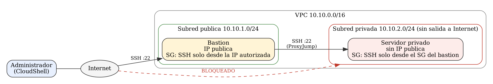

# 06 – Bastion host (Terraform)

## Solución
Un **bastion host** es un servidor expuesto a Internet que funciona como **único punto de entrada** hacia servidores privados.

- **Subred pública:** el bastion, con IP pública. Su security group solo acepta SSH desde una IP autorizada.
- **Subred privada:** el servidor de aplicación, **sin IP pública** y sin salida a Internet. Su security group solo acepta SSH desde el security group del bastion.
- Para llegar al servidor privado se salta por el bastion con `ProxyJump` de SSH.



## Cómo ejecutarlo (AWS CloudShell)
```bash
ssh-keygen -t ed25519 -f ~/lab-key -N ""
git clone https://github.com/Jaquimba23/cloud-patterns-lab.git
cd cloud-patterns-lab/06-bastion
MI_IP=$(curl -s https://checkip.amazonaws.com)
terraform init
terraform apply -var="public_key=$(cat ~/lab-key.pub)" -var="allowed_cidr=$MI_IP/32"
./demo.sh
```

## Resultado esperado
| Prueba | Resultado |
|---|---|
| SSH directo al servidor privado | BLOQUEADO (no tiene IP pública) |
| SSH al bastion | Conectado |
| SSH al servidor privado a través del bastion | Conectado |

## Limpieza
```bash
terraform destroy -var="public_key=$(cat ~/lab-key.pub)" -var="allowed_cidr=$MI_IP/32"
```
